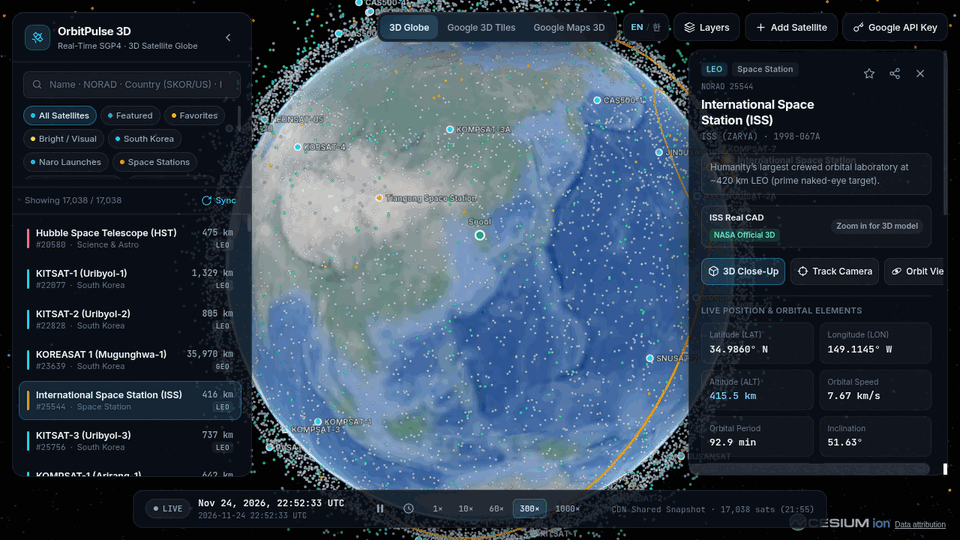
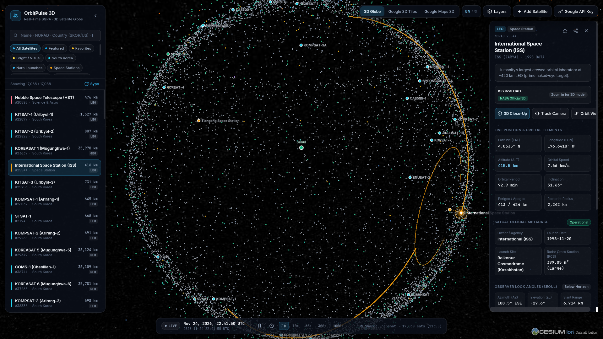
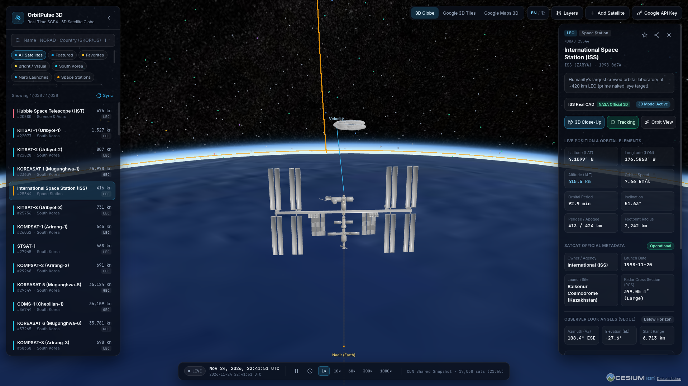
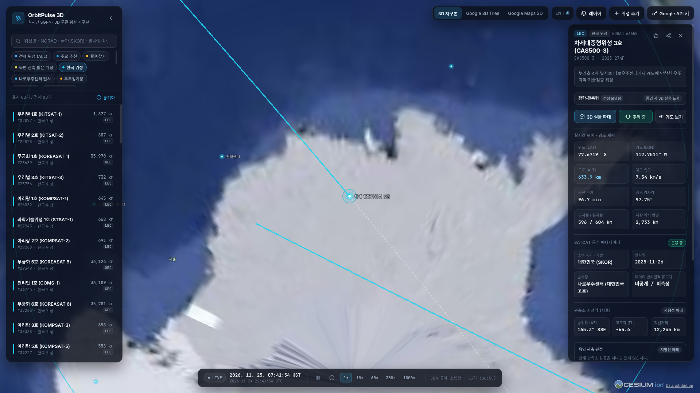
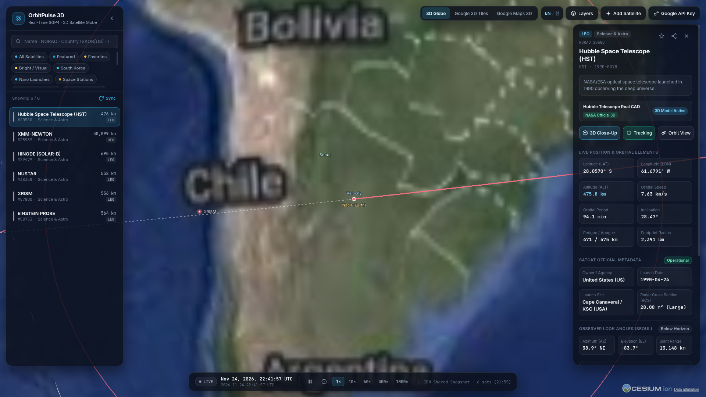
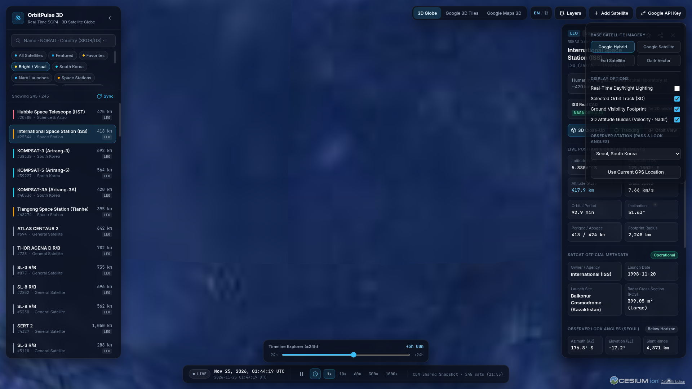
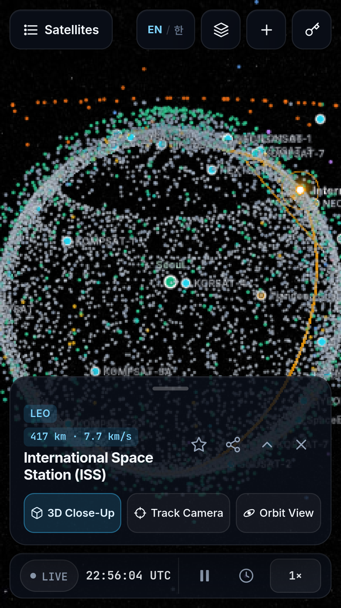
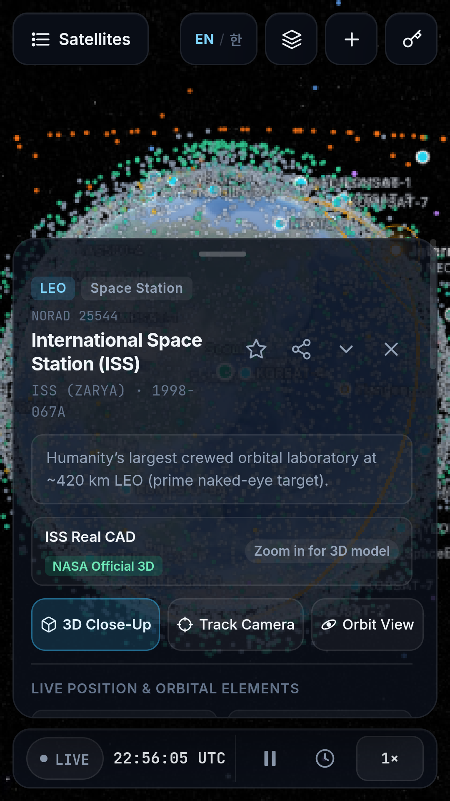

# OrbitPulse 3D — Real-Time 3D Satellite Tracker (실시간 인공위성 3D 추적기)



**CelesTrak** 무료 공개 전체 카탈로그(`GROUP=active` 17,000+기, 100% SATCAT 메타데이터 결합)와 **SGP4/SDP4 궤도 역학(`satellite.js`)** 을 이용해 지구 궤도 위 모든 공개 인공위성을 **3D 지구본(Google Hybrid / Photorealistic 3D Tiles / Google Maps 3D)** 위에 60fps로 실시간 추적·시각화하는 웹 애플리케이션입니다. **영어 기본(EN) + 한국어(한) 즉시 전환**을 지원합니다.

👉 **Live Demo**: https://knoxxr.github.io/satellite-tracker-3d/

## 주요 기능

- **무료 공개 전체 인공위성 실시간 추적 (17,000+기 · 18개 카테고리 · 100% SATCAT 메타데이터)**
  - **`All Active`** 모드에서 GPU `PointPrimitiveCollection` + 2단계 타임슬라이스 SGP4 엔진으로 **17,000기 이상 전 세계 활성 위성**을 60fps로 동시 렌더링하며, 카테고리별 색상으로 궤도 쉘(스타링크·OneWeb·GNSS·GEO·한국 위성 등)을 구분합니다.
  - **18개 무료 카테고리**: 전체 활성(`All`), 주요 추천, 즐겨찾기, **육안 관측 가능(`Bright/Visual`)**, **한국 위성 전체(`South Korea`, 83기+ · SATCAT `OWNER=SKOR`)**, **누리호 발사 위성(`Nuri/Naro`)**, 우주정거장, 기상, 지구관측(`Earth Obs`), 전세계 GNSS(`GPS`+`Galileo`+`GLONASS`+`BeiDou`+`SBAS`), 과학·천문, 정지궤도(`GEO`), 장타원·Molniya(`HEO`), 스타링크 전체, OneWeb·Iridium·Globalstar, 큐브·아마추어, 최근 30일 발사, 기타(`Other`).
  - **CelesTrak SATCAT 메타데이터**: 모든 위성의 국가/운영기관(`OWNER`), 발사일(`LAUNCH_DATE`), 발사장(`LAUNCH_SITE`), 레이더 단면적(`RCS` m² & 크기 등급) 표시.
  - **실시간 육안 관측 판정 엔진**: 태양 위치·지구 그림자(엄브라/페넘브라)·관측지 박명 상태를 천문학적으로 계산하여 **`Visible Now` / `Sunlit` / `Eclipsed` / `Daylight` / `Below Horizon`** 배지 및 향후 48시간 통과 일정별 **`★ Eye` / `★ 육안`** 판정 제공.
  - **무제한 동시 접속 대응 CDN 스냅샷 아키텍처**: GitHub Actions 3시간 주기 자동 갱신 + Singleflight / SWR / ETag 304 / IndexedDB 캐싱으로 다수 동시 접속 시에도 CelesTrak API 레이트리밋 차단 없이 초고속 로딩.
- **한영 다국어 지원 (`EN / 한` 즉시 전환, 영어 기본)**
  - 상단 헤더 `EN / 한` 토글 버튼으로 모든 UI·카테고리·SATCAT·육안 판정·통과 일정·3D 자세 가이드·Cesium 라벨 및 Google 하이브리드 지도 라벨 언어를 새로고침 없이 즉시 전환합니다.
- **3가지 3D 구글 지도 렌더링 모드 지원**
  1. **3D 지구본 (즉시 실행 · API 키 불필요)**: CesiumJS 3D 지구본 + Google 하이브리드/위성 타일 + 실시간 태양광(주/야간 경계선)
  2. **Google Photorealistic 3D Tiles**: Google Cloud **Map Tiles API** 키를 입력하면 실사 3D 건물·지형 지구본 위에 위성 궤도를 렌더링
  3. **Google Maps 3D 네이티브 (`<gmp-map-3d>`)**: Google **Maps JavaScript API (`maps3d`)** 기반 네이티브 3D 지도, `Marker3DInteractiveElement`, `Polyline3DElement` 지원
- **줌인 시 실제 3D 위성 모델 표시 (3단계 실물·추정 하이브리드 + 거리 기반 LOD)**
  - 우주 전체 뷰에서는 60fps 발광 포인트로 표시하다가, 위성에 **줌인**하거나 우측 패널의 **`3D Close-Up`** 버튼을 누르면 실제 3D 위성 모델로 자동 전환됩니다.
  - **1단계 · NASA 공식 실물 3D CAD (13종, Public Domain)**: ISS, 허블 우주망원경(HST), Terra, Aqua, Aura, Landsat 8/9, Suomi NPP / NOAA-20·21(JPSS), Chandra, TESS, CloudSat, CALIPSO, TDRS, Jason ([NASA 3D Resources](https://github.com/nasa/NASA-3D-Resources))
  - **2단계 · 공식 제원 기반 실제 형상 모델 (3종)**: 중국 톈궁(T자형 3모듈), 아리랑 5호(X-밴드 SAR 대형 평판 레이더), 천리안 2A/2B호·GOES-R(남측 외날개 태양전지판 + 북측 솔라세일 붐)
  - **3단계 · 유형별 추정 모델링 (6종)**: 실물 CAD 데이터가 없는 나머지 모든 위성(아리랑 광학형, 무궁화, GPS/Galileo, 스타링크 등)에 자동 적용되며, 모든 모델은 SGP4 속도·직하 방향 기반 **LVLH 비행 자세**로 실시간 회전합니다.
- **3D 궤도·가시권 분석 · 타임라인 · 모바일 · PWA**
  - 선택 위성의 과거/미래 3D 궤도 곡선, 직하선(Nadir Line), 지상 커버리지(Footprint) 및 근접 시 **진행·지구 방향 3D 화살표** 표시
  - 지상 관측소(서울, 대전 KARI, 부산, 제주, 내 GPS 위치 등) 기준 **방위각(AZ), 고도각(EL), 직선거리(km), 시선(LOS) 빔** 및 **향후 48시간 다건 통과 일정(최대 5회)** + **통과 시각 즉시 점프**
  - **±24시간 타임라인 스크러버**, 시간 배속(`1×` ~ `1000×`), 일시정지, 실시간(`LIVE`) 즉시 복귀
  - **즐겨찾기**(`localStorage`), `?sat=25544&closeup=1` **URL 딥링크 공유**, **모바일 바텀시트(Peek ↔ Expanded)** 및 **PWA 오프라인 설치** 지원

## 스크린샷

| 글로벌 3D 추적 (17,038기 · EN 기본) | NASA ISS 3D 실물 근접 |
|---|---|
|  |  |

| 한국 위성 83기 · 한국어 모드 (`한`) | NASA 허블 3D 실물 근접 |
|---|---|
|  |  |

| 육안 관측 목록 · 레이어 · ±24h 타임라인 | 모바일 메인 / 확장 바텀시트 |
|---|---|
|  |   |

## 실행 방법

```bash
# 의존성 설치
npm install

# 개발 서버 실행 (http://localhost:5173)
npm run dev

# 프로덕션 빌드 및 서버 실행 (http://localhost:3000)
npm run build
npm start
```

## Google Maps 3D API 키 설정 (선택 사항)

API 키 없이도 즉시 3D 위성 지구본으로 실행되며, 실사 3D 건물/지형(`Google Photorealistic 3D Tiles`) 또는 네이티브 `Google Maps 3D` 엔진을 사용하려면 다음 중 한 가지 방법으로 API 키를 설정하세요.

1. **앱 화면 우측 상단 `Google API 키` 버튼**에서 입력 (브라우저 `localStorage`에만 안전하게 저장)
2. 프로젝트 루트에 `.env` 파일 생성:
   ```env
   VITE_GOOGLE_MAPS_API_KEY=YOUR_GOOGLE_MAPS_API_KEY
   ```
   - `Google 3D Tiles` 사용 시 Google Cloud Console에서 **Map Tiles API** 활성화
   - `Google Maps 3D` 네이티브 엔진 사용 시 **Maps JavaScript API** 활성화
